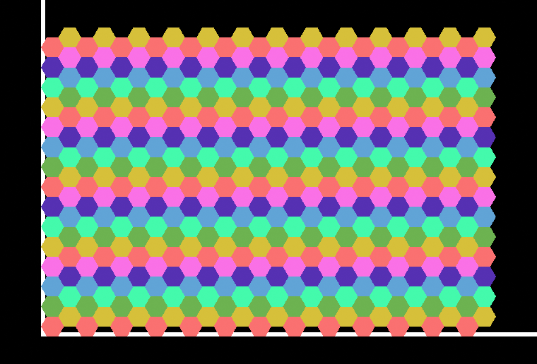

# Blender Hex Grid

Blender scripts that build a flat-top hexagon grid of four-triangle cells, coloured from a
palette of unlit materials so that no two touching cells share a colour.



There are two of them. They produce the same grid -- same positions, same cell shape, same
colouring, checked against each other by a test -- and differ only in how it is packaged.

| | [One object per cell](GenerateHexGrid.py) | [Single mesh](GenerateHexGridSingleMesh.py) |
| ------------------------- | ----------------------------- | --------------------------------- |
| Objects for 2,000,000 cells | 2,000,000                   | 1                                 |
| Build time at 2M cells      | 89.3 s                      | **8.3 s**                         |
| Peak memory at 2M cells     | 6.19 GB                     | **2.04 GB**                       |
| Per cell                    | 45 us                       | **4.2 us**                        |
| Colour carried by           | the object's material slot  | each polygon's `material_index`   |
| Select or move one cell     | in Object Mode              | only in Edit Mode                 |
| Hide, parent, animate a cell | yes                        | no                                |

**Use the single mesh unless you need cells to be separate objects.** It is an order of
magnitude cheaper in both time and memory, and the difference only grows with the grid. The
per-object version is there for when a cell has to be a thing in its own right -- something you
can click in the viewport, parent to a rig, or drive with its own keyframes.

## Using either one

1. Open Blender 4.5 or newer and switch an area to the Text Editor.
2. Paste the script in, or open it with **Text > Open**.
3. Edit `WIDTH` and `HEIGHT` near the top.
4. Press **Run Script**.

Progress goes to the system console (**Window > Toggle System Console** on Windows), because a
script run from the Text Editor freezes the interface until it finishes.

Blender 4.5 is the floor for the single-mesh script, which needs
`polygons.foreach_set("loop_start", ...)` to be writable.

## Settings

Both scripts keep every setting in one block at the top.

| Setting         | Default     | Script | What it does                                                   |
| --------------- | ----------- | ------ | --------------------------------------------------------------- |
| `WIDTH`         | `2000`      | both   | Cells across.                                                    |
| `HEIGHT`        | `1000`      | both   | Cells down.                                                      |
| `CELL_RADIUS`   | `1.0`       | both   | Centre to corner. Cells touch exactly at any radius.             |
| `COLOR_COUNT`   | `7`         | both   | Palette size. 3 is the minimum that can work; 7 gives a rosette. |
| `ADD_CAMERA`    | `True`      | both   | Add a top-down orthographic camera framing the grid.             |
| `PLAIN_COLORS`  | `True`      | both   | Set the view transform to Standard so unlit colours render true. |
| `GRID_NAME`     | `"HexGrid"` | both   | Names the collection, the objects and the materials.             |
| `SHARE_MESHES`  | `True`      | object | Cells of one colour share a mesh datablock.                      |
| `PROGRESS_ROWS` | `25`        | object | Print a progress line every this many rows. `0` turns it off.    |
| `BUILD_EDGES`   | `True`      | mesh   | Derive the edge list. Needed by edit mode and most modifiers.    |

## What the grid is

- **Flat-top hexagons**, matching HexelEditor's `HexOrientation.FlatTop`. Corners at 0, 60, 120,
  180, 240 and 300 degrees, so each cell has a flat edge top and bottom and a point left and right.
- **Four triangles per cell**, fanned from corner 0. The editor used the same decomposition while it
  drew its cells as a mesh; it draws them with a shader now, so this is the Blender script's own.
- **Flat on the XY plane at Z = 0**, occupying the **+X +Y quadrant only**. The bounding box starts
  exactly at the origin, so cell (0, 0) is the bottom-left one and nothing has a negative coordinate.
- **Unlit materials**, an emission shader each, with the viewport display colour set to match so
  Solid shading shows the palette without going into Material Preview.

Re-running replaces the previous grid rather than stacking a second one. Nothing outside the
grid's own collection is touched, apart from the view transform when `PLAIN_COLORS` is on.

In the single mesh, cells are laid out row by row: cell `(column, row)` owns vertices
`6n` to `6n + 5` and polygons `4n` to `4n + 3`, where `n = row * WIDTH + column`. A test pins
that down, because anything reading the mesh back depends on it. Cells do not share corner
vertices with their neighbours; sharing would save about two thirds of the vertices, but each
cell would stop being a separable fan, and touching cells of different colours need their own
corners anyway.

## The colouring

Hex centres form a triangular lattice. Taking a cell's axial coordinates `(q, r)`, the colour is

```
(q + 2r) mod COLOR_COUNT
```

Across the six neighbour directions `(1,0) (1,-1) (0,-1) (-1,0) (-1,1) (0,1)` that expression
changes by 1, -1, -2, -1, 1 and 2. None of those are zero modulo any `k >= 3`, so no two touching
cells can land on the same colour whatever the palette size, and no search or backtracking is
needed. Three is the chromatic number of this lattice, so `COLOR_COUNT` below 3 is rejected
rather than attempted.

## Cost

Measured with Blender 4.5.14 on a 24 core desktop, building only -- no saving, no rendering.

| Grid        |     Cells | One object per cell | Single mesh    |
| ----------- | --------: | ------------------- | -------------- |
| 400 x 200   |    80,000 | 2.8 s, 0.40 GB      | 0.4 s, 0.25 GB |
| 1000 x 500  |   500,000 | 20.8 s, 1.71 GB     | 1.9 s, 0.64 GB |
| 2000 x 1000 | 2,000,000 | 89.3 s, 6.19 GB     | 8.3 s, 2.04 GB |

Both are linear in the cell count. The per-object cost is Blender's per-object overhead rather
than the geometry, which is why four triangles a cell is not what makes a large grid expensive
and halving that count would not help. The single mesh avoids that overhead entirely and spends
its time filling flat buffers instead.

Building is only part of the story. Two million objects also make the viewport heavy and the
outliner close to unusable; one object with eight million triangles does not. Prefer Solid
shading either way.

### A trap worth knowing about, in the per-object script

Blender keeps each kind of datablock in a list sorted by name. When a new name sorts after
everything already in the list the insert is cheap; when it does not, Blender scans backwards to
find the spot and creating *n* objects becomes O(n squared).

Naming cells `HexGrid_<column>_<row>` without padding does exactly that, because `_10_` sorts
before `_2_`. Measured at 80,000 cells:

| Naming                                  | Per cell | 80,000 cells |
| --------------------------------------- | -------: | -----------: |
| `Name_<column>_<row>`, unpadded         |  2085 us |      167 s   |
| `Name_r<row>_c<column>`, zero-padded    |    31 us |        2.5 s |

So cells are named `HexGrid_r0000_c0000`, zero-padded, row before column, and built row by row,
which keeps every insert at the end of the list. A test locks this in: it recovers each cell's
column and row from where it actually sits and checks that sorting by name reproduces row-major
order. The single-mesh script creates one datablock, so none of this applies to it.

## The demo file

```
pwsh -File ./MakeDemo.ps1
```

or double-click `MakeDemo.cmd`. It builds a 2000 x 1000 grid with the single-mesh script and
saves it under `Output`, which is gitignored: the file is far too large for the repository and
rebuilds from the script in seconds. `-Width`, `-Height`, `-Colors`, `-OutputPath` and
`-NoCompress` are all available.

The 2000 x 1000 file measures:

| | |
| ------------------- | ------------------------------------------- |
| Cells               | 2,000,000                                    |
| Vertices, polygons  | 12,000,000 and 8,000,000                     |
| Build, save, reopen | 9.5 s, 0.4 s, 0.7 s                          |
| On disk             | 193 MB compressed, 2.04 GB peak while building |

Afterwards it is opened again and checked, because saving and re-opening is where a mesh filled
through `foreach_set` would show any damage. The check is exhaustive rather than sampled: all six
neighbour directions, for all two million cells.

**Zoomed all the way out the grid looks grey, and that is correct.** Two thousand columns across
a thousand-pixel viewport is half a pixel per cell, so seven saturated hues average to a neutral.
Zoom in and the colours are there. The `GridPreview.png` above is a small grid for that reason.

## Tests

```
pwsh -File ./Test.ps1
```

or double-click `Test.cmd`. Both suites run. Output lands in a timestamped folder under
`LogOutput`.

| Switch      | What it adds                                                                       |
| ----------- | ---------------------------------------------------------------------------------- |
| `-Measure`  | Times both generators at increasing sizes, up to two million cells. Several minutes. |
| `-InEditor` | Runs each through Blender's Text Editor in a real window, and screenshots it.        |

The tests execute the real script text with only its settings constants rewritten, so what is
tested is the file you would paste. The adjacency tests deliberately ignore the colouring formula
and work from the built scene: they derive each cell's position from its geometry, find
neighbours by measuring distances, and compare the materials actually found there, so a colouring
bug that was wrong in both the generator and a re-implementation would still be caught. A final
test builds the same grid through both scripts and checks they agree cell for cell.

`-InEditor` covers what the automated tests cannot. They reach the generators with `exec`, which
is close to how Blender runs a script but not the same path: it does not go through
`bpy.ops.text.run_script`, a text datablock, or a real window with a depsgraph and a viewport
behind it. The window is placed on a display nobody is working on -- `NE18NZ2` on this machine,
overridable with `-MonitorName`, falling back to the largest non-primary display -- and opened
with `--no-window-focus`, so it never takes the foreground.

## Files

| File                                                       | What it is                                             |
| ---------------------------------------------------------- | ------------------------------------------------------ |
| [GenerateHexGrid.py](GenerateHexGrid.py)                   | One object per cell. Paste into Blender.                |
| [GenerateHexGridSingleMesh.py](GenerateHexGridSingleMesh.py) | One mesh for the whole grid. Paste into Blender.      |
| [TestHexGrid.py](TestHexGrid.py)                           | Tests for the per-object script.                        |
| [TestHexGridSingleMesh.py](TestHexGridSingleMesh.py)       | Tests for the single-mesh script, and the cross-check.  |
| [MeasureHexGrid.py](MeasureHexGrid.py)                     | Times and measures one grid size, for either script.    |
| [RenderPreview.py](RenderPreview.py)                       | Renders the preview image above, with the axes drawn in. |
| [ValidateInEditor.py](ValidateInEditor.py)                 | Runs a script through a real Blender window's Text Editor. |
| [MakeDemoFile.py](MakeDemoFile.py)                         | Builds a grid and saves it as a .blend.                 |
| [BlenderTools.ps1](BlenderTools.ps1)                       | Shared helpers: finding Blender, picking a free display. |
| [Test.ps1](Test.ps1)                                       | Runs everything. See the switches above.                |
| [MakeDemo.ps1](MakeDemo.ps1)                               | Writes the demo .blend.                                 |
