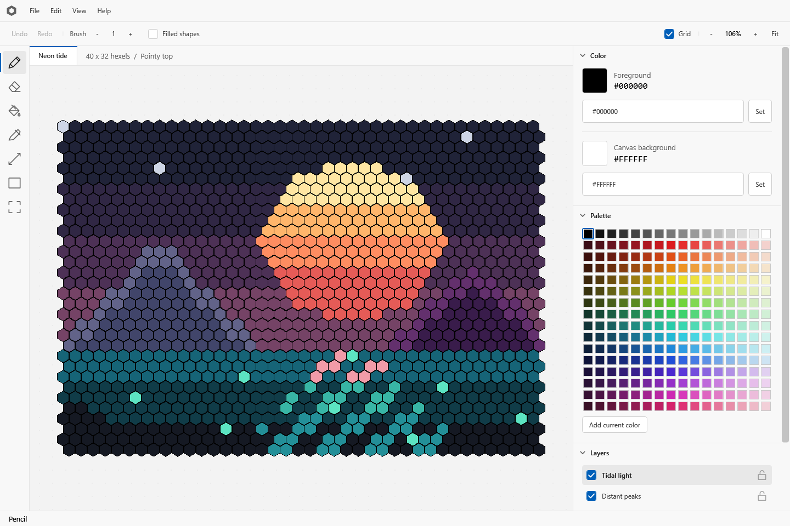

# Hexel Editor

A desktop art editor for a hexagonal grid, built with C#, .NET 10, WPF, and SkiaSharp. Development and releases target Windows 11 x64. The interface is a light, grayscale theme modelled on Visual Studio Code's default light theme: a menu bar, a tool rail, the canvas with its document tab, and collapsible side bar sections.



Double-click `Build.cmd` at the repository root to build the editor, then double-click `Run.cmd` to start it. The wrappers use modern PowerShell. From a terminal:

```powershell
pwsh -File ./Build.ps1
pwsh -File ./Run.ps1
```

Build restores NuGet dependencies and creates the Release build. Run exits with an error if that build is missing; it never builds the app. Run starts the editor from a fresh copy of the build under `Artifacts/Run`, so an open editor never locks the build output and a build can run while the editor is open. Each run makes its own copy; copies left by editors that have exited are deleted on the next run. The "Neon tide" example opens with three editable layers. Use File > New canvas for a blank document, or open `Examples/NeonTide.hexel`.

## Editing

- Pointy-top and flat-top grids, up to 2048 columns and 2048 rows, and two million hexels in all.
- Pencil and eraser with hexagonal brushes, connected flood fill, eyedropper, lines, and outlined or filled rectangles.
- Rectangular selections, cell copying and pasting, movement, and exact 60-degree rotations. Transforms clip at the canvas boundary and can be undone.
- Layers with names, visibility, locking, opacity, and ordering, each holding its own cells.
- Editable color values (`#RRGGBB` or `#AARRGGBB`) and a project palette. The palette opens as a 16 by 16 grid of 256 colors:
  a grey ramp from black to white, then one row per hue shaded dark to light. Colors you add appear below the grid.
- A solid canvas background under every cell, white on a new canvas and changeable at any time from the Color side bar section or View > Canvas background color. It is saved with the project and can be undone like any other edit.
- Stroke-level undo/redo, a saved-state indicator, and a prompt before replacing unsaved artwork.
- Compressed `.hexel` projects.

The current release supports up to 32 layers, 2,200,000 hexels with neither side over 2048, and 512 palette colors, 256 of which a new project starts with. A 2000 by 1000 canvas is within that and is the size the editor is built to stay responsive at. Layers are limited further on a large canvas by a 256 MB budget for cell data. Undo history retains up to 200 commands within a 64 MiB budget, keeping at least the most recent command. A painting command records the cells it changed, and a structural one - a layer added, hidden, renamed, reordered or made see-through, a palette colour, the canvas background - records the structure only and shares the cells, so neither grows with the size of the canvas. Copy/paste uses an internal cell clipboard. Animation, bitmap import, and image export are not implemented.

## Shortcuts

| Action                              | Shortcut                              |
| ----------------------------------- | ------------------------------------- |
| Pencil / eraser / fill / picker     | B / E / G / I                         |
| Line / rectangle / selection        | L / U / M                             |
| Erase with current brush            | Right mouse button                    |
| Temporarily pick a color            | Alt + click                           |
| Decrease / increase brush radius    | [ / ]                                 |
| Pan                                 | Space + drag, or middle mouse + drag  |
| Zoom                                | Mouse wheel at cursor, or + / -       |
| Fit canvas / toggle grid            | F / H                                 |
| New / open / save                   | Ctrl+N / Ctrl+O / Ctrl+S              |
| Save as                             | Ctrl+Shift+S                          |
| Undo / redo                         | Ctrl+Z / Ctrl+Y, or Ctrl+Shift+Z      |
| Copy / cut / paste at cursor        | Ctrl+C / Ctrl+X / Ctrl+V              |
| Select all / deselect               | Ctrl+A / Ctrl+D                       |
| Move selected cells                 | Arrow keys                            |
| Rotate clockwise / counterclockwise | Ctrl+R / Ctrl+Shift+R                 |
| Clear selected cells or layer       | Delete or Backspace                   |
| Deselect                            | Esc                                   |

## Build and verification

Install the .NET 10 x64 SDK and PowerShell 7 if they are not already available. Visual Studio is optional. The SDK includes the WPF build tools. NuGet downloads require internet access on the first restore. Dependency versions and lock files are checked into the repository.

```powershell
pwsh -File ./Build.ps1
pwsh -File ./Scripts/Test.ps1
pwsh -File ./Scripts/Validate.ps1
pwsh -File ./Scripts/Verify.ps1
pwsh -File ./Scripts/Exercise.ps1
pwsh -File ./Scripts/Publish.ps1
```

- Build compiles the complete solution in Release mode with warnings treated as errors.
- Test builds and runs the xUnit suite in process, without needing VSTest's interprocess service. It covers hex geometry, editing, compositing, selections, undo/redo, layer operations, and project persistence.
- Validate is the entry point to use while someone is working on this machine, and the one an agent should use. It runs Verify, puts the real window on the validation display, and watches the whole run for anything that would disturb whoever is at the keyboard. See "Validating without disturbing anyone" below.
- Verify also starts a hidden WPF rendering host, renders the real editor, opens the menu bar, lays out the dialogs, saves and reloads the example, draws it and samples every cell to confirm each one's composited color lands at that cell, draws a canvas in both orientations and confirms the background is one solid color under a cell holding no artwork and that nothing shows between neighboring opaque cells, draws three canvases of one size in turn and confirms each shows its own cells rather than the last one's, lays out the palette grid and chooses and adds a color through its real controls, draws a canvas at each of the cell sizes a cell is really drawn at and checks that a cell's color lands where that cell is, drives the pointer across the canvas, and checks session logging. Everything it claims about drawing goes through the shader the editor draws with, so none of it can pass on a renderer nobody sees. It asserts that every check reported, so an application that exits early cannot pass by silence. Its logs and generated artifacts go to a timestamped folder under `LogOutput`. No physical display is used.
- Exercise is the disruptive counterpart of Validate, for a machine nobody is using. It opens the real editor on the displayed desktop, takes the foreground, and drives it the way a hand does: the pointer and keyboard through `SendInput`, the menus through their own items, the dialogs opened and answered, the file dialog told where to save. It checks what the hidden host cannot: that Escape and the arrows reach an open menu, that a click lands on the cell under the pointer at the display's real scale, that a project saves through the dialog and opens again from the command line, that a corrupt project is refused with a message, that the unsaved-changes prompt is asked and answered, and how many frames a second the window draws under a drag over a 2000 by 1000 canvas. Every stage is photographed into a timestamped `Exercise_` folder under `LogOutput`. See "Exercising the editor by hand" below.
- Publish creates a self-contained application at `Artifacts/Release/HexelEditor.exe`. Copy the entire Release folder to another Windows 11 x64 computer; no separate .NET installation is needed. Publishing uses separate intermediate outputs from development builds.

Scripts store the CLI home, NuGet cache, test temporary files, and build outputs inside the ignored `Artifacts` directory or the projects' ignored `bin` and `obj` folders. The root build and run scripts share the executable path `Source/HexelEditor.Desktop/bin/Release/net10.0-windows10.0.26100.0/win-x64/HexelEditor.exe`. Both accept `-Configuration Debug` for a Debug build. `Run.ps1 -Project 'C:\Artwork\Scene.hexel'` opens a project at startup.

### Validating without disturbing anyone

The editor is developed with agents on a machine that someone is using at the same time. One display, `NE18NZ2`, is set aside for validation and may show anything. Every other display belongs to the user, and nothing may appear there even for a single frame, nor may anything take the keyboard. Both states of the machine are supported: locked and unlocked behave the same, and no check is skipped in either.

```powershell
pwsh -File ./Scripts/Validate.ps1
```

That is the entry point. It builds, runs the tests, drives the real interface in a hidden rendering host, puts the real window on `NE18NZ2`, photographs it, and exits non-zero if the run disturbed the machine. Each run writes `Validation.txt`, `Validation.json`, the captured window, and the verification output to a timestamped folder under `LogOutput`. `-SkipDisplayPass` leaves out the only step that uses a display; `-Display` names a different one.

Two things make it safe, and the second is the one that matters.

**Everything is built to stay out of the way.** The checks that drive the interface run in a hidden host with no window on any display. The window that does appear is placed from `SourceInitialized`, which runs after its handle exists and before it is made visible, so it never appears anywhere else on the way to `NE18NZ2`. It carries `WS_EX_NOACTIVATE`, so it cannot be given the foreground by any amount of focusing or stray clicking, it is kept out of the taskbar so there is no button to appear or flash there, and the editor skips the focus calls it normally makes while loading. `PrintWindow` with `PW_RENDERFULLCONTENT` asks the window to draw itself, so photographing it needs neither the foreground nor an unobstructed view; the picture is taken again until it holds something, because a window photographed before its first frame, which on a machine busy with a game is a gap wide enough to land in, reads as one that cannot draw. The window is then asked to close through the handle the capture found, since a window kept out of the taskbar has an owner and is no main window to `Process.CloseMainWindow`. Windows Error Reporting is suppressed for these runs, so a crash cannot put a dialog on a user display; the session log and the exit code carry the diagnosis instead.

**The whole run is watched, and a run that disturbed the machine fails.** Care is an intention; the watch is evidence. `SetWinEventHook` records the moment any window gains `WS_VISIBLE` together with the bounds it had at that moment, which polling cannot promise, because a window shown and then moved between two samples would slip through. A sampler follows the foreground window and the cursor clip alongside it. The run fails, naming the window, if one of its windows became visible outside `NE18NZ2`, moved onto a user display, took the foreground, captured the mouse, or confined the cursor.

The watch was worth building: it showed that an offscreen window is not enough on the desktop being displayed. There the hidden host takes the foreground, the menu check captures the real mouse, and the submenu's own popup window becomes visible at the top left of the primary display. So the hidden host runs on a Win32 desktop of its own. A desktop owns its windows and its input state, and only one desktop per window station is displayed and fed by the keyboard at a time; one created for a validation run is never that one, so a window there cannot appear on a display, take the foreground, or reach the user's keyboard whatever the program does.

That trade costs one thing, and it is recorded rather than hidden. A desktop that is not the input desktop has no foreground window, and mouse capture needs one, so a WPF menu will not stay open through its menu item there. The submenu is opened directly and measured instead, and the report says which path was taken: the fallback is correct without an input desktop and a defect with one. `Validate.ps1 -SameDesktop` runs the host on the displayed desktop for the stronger menu check, and is only for a machine nobody is using. The watch then covers the display pass alone, since the host is allowed to do there what the watch exists to catch. The first time that switch was run after the pointer checks were added, it found the menu check leaving the menu holding the mouse, so that every driven pointer move after it landed on the menu; the check now gives the capture back and asserts that nothing holds the mouse when it is done. On that path it also closes the open menu with Escape, raised as the two routed events a struck key raises, tunnel then bubble, because striking the key would need the keyboard focus, and taking that before the pointer checks makes WPF re-read the pointer from the physical cursor; the keyboard check at the end of the run strikes a tool key with the File item focused instead, and holds the tool to what it was.

Reading the automation tree of the window on `NE18NZ2` is safe, but `InvokePattern.Invoke` activates the window whatever the control does, so clicking belongs in the hidden host instead.

### Driving the pointer

Painting is what the editor is for, so the canvas is checked by driving the pointer rather than by calling into it. `PointerInput` sends the window messages a mouse sends, which is the only way to do it: raising `MouseDown` on a control skips hit testing, so it would pass on a canvas that something had covered, that had no size, or that had been taken out of hit testing; and a hand-made `MouseEventArgs` cannot carry a position, because `GetPosition` asks the mouse device, which answers with wherever the physical pointer happens to be. A message carries the position WPF then reports, and arrives through the provider a real mouse arrives through, so hit testing, mouse capture and the order of enter, move, down and up are the real ones.

Covered: hit testing from the root, hover tracking, capture taken for a stroke and given back after it, a nine-cell drag that only joins up if the cells between two reported positions are filled in as well, one gesture being one undo however many moves it was made of, right-button erase, and a middle-button pan that moves the canvas without painting. These run on a blank canvas, so a cell holds the stroke or holds nothing and an erase is not a question about compositing.

This is why the hidden host is marked visible despite never being shown. WPF hit tests pointer input by asking the window manager which window lies at a point, and the window manager only answers with visible windows; without `WS_VISIBLE` a driven position arrives correctly and then lands on nothing, so no element sees a mouse event. The host is parked at -30000,-30000, which no monitor covers, and runs on a desktop that is not displayed, so visible costs nothing. The watch knows that a window on no display shows nothing, and still objects to one that overlaps a user display by as little as a pixel.

A check that fails after driving the pointer ends the process instead of asking WPF to shut down, because a shutdown from mid-gesture hung until the timeout and buried the reason. Failures report in about five seconds.

### Driving the keyboard

The shortcut table is struck rather than called. Keys go to the host window as key messages, and the modifiers are genuinely held down, so `OnKeyDown` reads the modifier state it would read under a hand. Covered: all seven tool keys, the brush and grid keys, `Space` held and released so `OnKeyUp` is reached as well, and `Ctrl+A`, `Ctrl+D`, `Ctrl+Z` and `Ctrl+Shift+Z`. Nothing there opens a dialog or touches the clipboard: `Ctrl+N`, `Ctrl+O` and `Ctrl+S` would wait on a modal window nobody can answer, and the clipboard belongs to the window station, which is shared with whoever is using the machine.

Holding the modifiers takes explaining. A shortcut is read through `Keyboard.Modifiers`, which WPF answers by asking the operating system whether Control is down, and a key message does not change that state, so Control would never be held. The obvious answer, injecting input with `SendInput`, cannot be used: injected input only ever feeds the desktop being displayed, and answers `ERROR_ACCESS_DENIED` from anywhere else, so it does nothing on a desktop of its own and would type into someone's session on the displayed one. `SetKeyboardState` is the way through, because it changes the calling thread's key state only, which is the state WPF reads; nothing outside the process can see it, and the messages go to one window this process owns.

WPF's own focus is enough to route keys, and taking the Win32 focus is actively harmful: it makes WPF work out afresh where the pointer is by asking the system, and on a desktop that is not displayed there is no cursor to report, so it settles on a position outside the window and stops accepting driven pointer moves for good. That is why the pointer checks run before the keyboard ones, and why the stroke these keys undo is made through the session rather than with the pointer.

The shortcut handlers are on the content root as well as on the window, because validation hosts the window's content without the window, and a tunneling event would otherwise never pass through them. The window still receives a key first and marks it handled, so nothing about the editor's behavior changes; the content root matters only where there is no window.

Two details about Windows worth keeping in mind here. A locked Windows 11 session draws its lock screen on the `Default` desktop and only switches to `Winlogon` for the credential prompt, so the input desktop still reads as `Default` while the machine is locked; the lock state comes from the session flags, and the two questions are answered separately. And a desktop does not get its own clipboard, because the clipboard belongs to the window station, so validation leaves the system clipboard alone.

### Exercising the editor by hand

```powershell
pwsh -File ./Scripts/Exercise.ps1
```

Everything above is built never to take the foreground, move the real pointer or type on the real keyboard. This does all three on purpose, so it is only for a machine nobody is using: a person's keystrokes would land in the editor and the editor's in their work. It cannot run on a desktop of its own, because `SendInput` only ever feeds the desktop being displayed.

What it covers is what nothing else can. The hidden host drives the editor with window messages, which reach the editor's own handlers; real input goes through the window manager first, so the menu's own popup window, the file dialog, the message boxes and the foreground are all the real ones. The run found, the first time it was made, that Escape did not close an open menu and the arrow keys moved the selection instead of walking the menu: the window's shortcut handler sees every key before the menu does, and took them. It now steps aside while a menu owns the keyboard, and the exercise presses Down and Escape on the File menu to hold it there.

Each run starts the editor the way a person would, in front on the primary display, and reads the interface back through UI Automation, which is what a screen reader sees. The window's named controls carry their names, the buttons their automation names, and the dialogs are windows of the same process. The canvas has no automation peer, so it is found from the layout around it; the status bar naming the cell under the pointer is what says the mapping is right. `-Display` opens the editor on a named display instead, and `-LeaveOpen` leaves it running at the end rather than closing it through the unsaved-changes prompt.

## Session logs

Every editor run creates `LogOutput/yyyy-MM-dd_HH-mm-ss` at the repository root, including direct executable launches. `Session.log` records startup, shutdown, project opens and saves, and errors with exception details. Sessions started within the same second wait for the next available timestamp so their logs stay separate. `LogOutput/` is ignored by Git. For a published application copied outside the repository, `LogOutput` is created beside the executable.

## Source layout

- `Source/HexelEditor.Core`: document model, axial/offset geometry, six-neighbor algorithms, editing history, example artwork, and project serialization. It has no WPF or Skia dependency.
- `Source/HexelEditor.Desktop`: WPF interface, pointer and keyboard handling, and Skia canvas. `App.xaml` holds the whole theme: color brushes and the control templates for buttons, inputs, menus, scroll bars, and side bar sections. Each hexel is data, rather than a separate WPF control: `GpuHexRenderer` draws the artwork, the selection and the rectangle being dragged out as one shaded rectangle, `ArtworkCache` keeps the composited colors it reads and `SelectionMask` the cells it marks, while `CanvasGeometry` carries the layout that the line preview and the cursor ring are still drawn from on the CPU. The canvas is a GL framebuffer WPF composites directly, so a frame is drawn where it is shown and never read back; the one GL context belongs to the canvas element, on the interface thread, and the renderer over it lives for the whole session. `MainWindowVerification.cs` holds the checks the window runs against itself, as part of the same class but out of the way of it.
- `Tests/HexelEditor.Tests`: xUnit tests for the editing core.
- `Build.cmd` / `Build.ps1` and `Run.cmd` / `Run.ps1`: repository-root build and run entry points. Run launches a copy of the build so that editing and building the repository never wait on a running editor.
- `Scripts`: shared PowerShell helpers, tests, verification, validation, measurement, and publishing. The shared helper requires PowerShell 7 or later. `Validate.ps1` is the entry point for checking a change; `Exercise.ps1` drives the real editor under real input on a machine nobody is using; `Measure.ps1` times the editor's own work on a desktop of its own and writes a report under `LogOutput`; `DisruptionGuard.ps1` watches a run for interference and answers what the session state is, `IsolatedDesktop.ps1` runs a process on a Win32 desktop of its own, and `Windowing.ps1` measures displays, finds a process's window, and photographs one without activating it. For what the window does under a real hand rather than what the editor spends per frame, `Run.ps1 -EditorArguments --log-frames` starts the editor writing how many frames it drew, and how far apart, to its session log every two seconds while frames are being drawn.
- `Documentation`: images used by this file.
- `Examples`: the saved example project.
- `Conversations`: the verbatim conversation history required by `AGENTS.md`.

Project files are ZIP archives containing `Document.json` and little-endian 32-bit ARGB buffers at `Cells/<layer>.bin`. Saves replace the destination only after writing a complete temporary archive. Loads validate dimensions, buffer lengths, and resource limits before creating cell buffers. The reader accepts the current format only; no migration or backward-compatibility layer is maintained.
