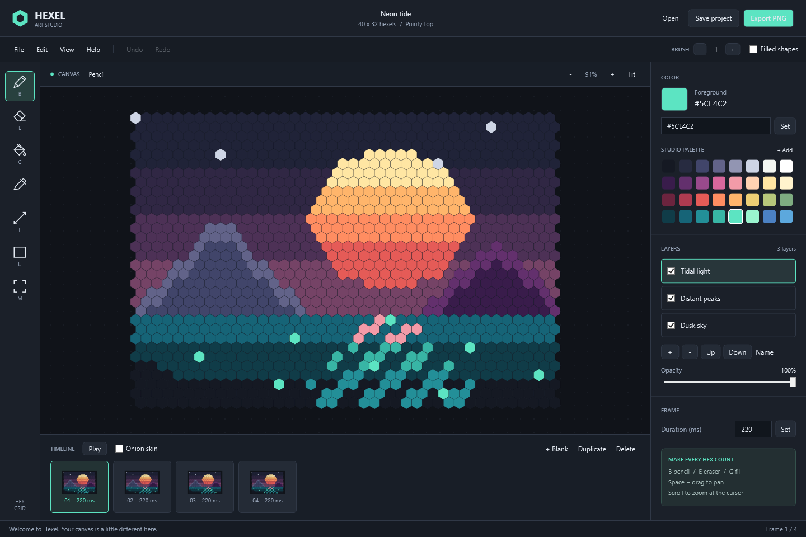

# Hexel Editor

A desktop art and animation editor for a hexagonal grid, built with C#, .NET 10, WPF, and SkiaSharp. Development and releases target Windows 11 x64.



Launch from the repository root with modern PowerShell:

```powershell
pwsh -File ./Scripts/Launch.ps1
```

The first launch builds the app and restores its NuGet dependencies. The animated "Neon tide" example opens with four editable frames and three layers. Use File > New canvas for a blank document, or open `Examples/NeonTide.hexel`.

## Editing

- Pointy-top and flat-top grids, up to 256 columns and 256 rows.
- Pencil and eraser with hexagonal brushes, connected flood fill, eyedropper, lines, and outlined or filled rectangles.
- Rectangular selections, cell copying and pasting, movement, and exact 60-degree rotations. Transforms clip at the canvas boundary and can be undone.
- Layers with names, visibility, locking, opacity, and ordering. Every animation frame has an independent cel for each layer.
- Blank and duplicate frames, per-frame timing, looping playback, and previous-frame onion skinning.
- Editable color values (`#RRGGBB` or `#AARRGGBB`) and a project palette.
- Stroke-level undo/redo, a saved-state indicator, and a prompt before replacing unsaved artwork.
- Compressed `.hexel` projects, transparent PNG and SVG export, and horizontal PNG animation sprite sheets.

The current release supports up to 32 layers, 128 frames, and 16,777,216 cells across all cels. Undo history retains up to 200 commands within a 64 MiB budget, keeping at least the most recent command. Copy/paste uses an internal cell clipboard. Standard bitmap import and animated GIF export are not implemented.

## Shortcuts

| Action                              | Shortcut                              |
| ----------------------------------- | ------------------------------------- |
| Pencil / eraser / fill / picker     | B / E / G / I                         |
| Line / rectangle / selection        | L / U / M                             |
| Erase with current brush            | Right mouse button                    |
| Temporarily pick a color            | Alt + click                           |
| Decrease / increase brush radius    | [ / ]                                 |
| Pan                                 | Space + drag, or middle mouse + drag  |
| Zoom                                | Mouse wheel at cursor, or + / -       |
| Fit canvas / toggle grid            | F / H                                 |
| New / open / save                   | Ctrl+N / Ctrl+O / Ctrl+S              |
| Save as                             | Ctrl+Shift+S                          |
| Undo / redo                         | Ctrl+Z / Ctrl+Y, or Ctrl+Shift+Z      |
| Copy / cut / paste at cursor        | Ctrl+C / Ctrl+X / Ctrl+V              |
| Select all / deselect               | Ctrl+A / Ctrl+D                       |
| Move selected cells                 | Arrow keys                            |
| Rotate clockwise / counterclockwise | Ctrl+R / Ctrl+Shift+R                 |
| Clear selected cells or cel         | Delete                                |
| Play / stop                         | Enter                                 |
| Previous / next frame               | , / .                                 |
| Deselect and stop playback          | Esc                                   |

Export the current frame using the top-right Export PNG button. File also contains SVG and sprite-sheet exports. PNG uses a 16-pixel hexagon radius with transparency and no editor grid. Sprite-sheet frames have equal dimensions and run left to right in timeline order; their timings remain in the project. SVG preserves hexagon geometry and alpha. Layer order, visibility, and opacity affect exports.

## Build and verification

Install the .NET 10 x64 SDK and PowerShell 7 if they are not already available. Visual Studio is optional. The SDK includes the WPF build tools. NuGet downloads require internet access on the first restore. Dependency versions and lock files are checked into the repository.

```powershell
pwsh -File ./Scripts/Build.ps1
pwsh -File ./Scripts/Test.ps1
pwsh -File ./Scripts/Verify.ps1
pwsh -File ./Scripts/Publish.ps1
```

- Build compiles the complete solution in Release mode with warnings treated as errors.
- Test builds and runs the xUnit suite in process, without needing VSTest's interprocess service. It covers hex geometry, editing, compositing, selections, undo/redo, layer and frame operations, and project persistence.
- Verify also starts a hidden WPF rendering host, renders the real editor, saves and reloads the example, and checks PNG, SVG, and sprite-sheet exports. Output goes to a timestamped folder under `Artifacts/Verification`. No physical display is used.
- Publish creates a self-contained application at `Artifacts/Release/HexelEditor.exe`. Copy the entire Release folder to another Windows 11 x64 computer; no separate .NET installation is needed. Publishing uses separate intermediate outputs from development builds.

Scripts store the CLI home, NuGet cache, test temporary files, and generated outputs inside the ignored `Artifacts` directory. `Launch.ps1 -NoBuild` starts an existing Release build. `Launch.ps1 -Project 'C:\Artwork\Scene.hexel'` opens a project at startup.

## Source layout

- `Source/HexelEditor.Core`: document model, axial/offset geometry, six-neighbor algorithms, editing history, example artwork, and project serialization. It has no WPF or Skia dependency.
- `Source/HexelEditor.Desktop`: styled WPF interface, pointer and keyboard handling, Skia canvas, animation playback, and image exporters. The canvas uses Skia's software rendering through WPF with viewport culling; each hexel is data, rather than a separate WPF control.
- `Tests/HexelEditor.Tests`: xUnit tests for the editing core.
- `Scripts`: PowerShell build, launch, test, verification, and publishing entry points.
- `Conversations`: the verbatim conversation history required by `AGENTS.md`.

Project files are ZIP archives containing `Document.json` and little-endian 32-bit ARGB buffers at `Cells/<frame>/<layer>.bin`. Saves replace the destination only after writing a complete temporary archive. Loads validate dimensions, frame durations, buffer lengths, and resource limits before creating cell buffers. The reader accepts the current format only; no migration or backward-compatibility layer is maintained.
